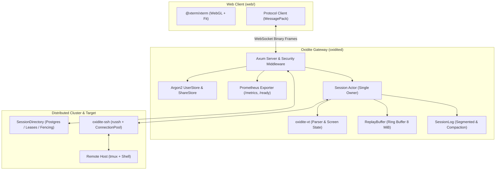

# Oxidite

> **OffCampus Code:** `FVE2EN`

A browser-based terminal platform backed by a high-performance Rust session server (`oxidited`).

The browser is the client. The server owns the shells. Sessions live on the server, survive browser disconnects, connect to remote machines over SSH, keep those SSH connections healthy, and can be shared between users and spread across multiple server nodes.

```
Browser (xterm.js)  ⇄  WebSocket (MessagePack, Resumable)  ⇄  Gateway Node (oxidited)  ⇄  Target Host (SSH / PTY)
```

---

## Key Capabilities

1. **Persistent Server-Owned Sessions**: Terminal sessions live on the gateway, surviving browser tab closes, network disconnects, and client restarts.
2. **Resumable WebSocket Protocol**: Output stream indexed by 64-bit cumulative byte offsets. On reconnect, missing bytes are streamed from an 8 MiB ring buffer or instantly restored via ANSI repaint snapshot without duplicates or gaps.
3. **Resilient SSH Engine**: Native `russh` client with Trust-On-First-Use (TOFU) host-key prompts, keepalive monitoring, full-jitter exponential reconnect backoff, connection pooling, and remote `tmux` persistence (`tmux new-session -A -s oxidite-<id>`).
4. **Real-Time Collaboration**: Multi-client sharing on a single session. Enforces a single active writer with takeover capability, broadcasts presence notifications, and streams to $N$ viewers with independent ack windows. Stalled viewers are resynced from snapshots without delaying the writer.
5. **Distributed Multi-Node Clustering**: Gateway nodes coordinate through a centralized directory with TTL leases and monotonically increasing fencing tokens. If a gateway node crashes, peer nodes detect orphaned sessions and adopt them transparently. Network partitions never produce split-brain writers.
6. **Hardened Security by Default**: Argon2id password hashing, rotating session tokens, per-user ownership enforcement on all operations, TLS required on non-loopback binds, Origin header validation against CSWSH, rate limiting, and zero logging of keystrokes, passwords, or terminal output.
7. **Durability & Observability**: Append-only segmented session logs with compaction, asciicast v2 session export, live Prometheus metrics at `/metrics`, readiness probe at `/ready`, and per-session tracing spans.

---

## Workspace Architecture



### Crate Boundaries

- **`crates/oxidite-vt`**: Parser, terminal state machine, grid, damage tracking, and screen repaint snapshot serializer. Zero network or GPU dependencies.
- **`crates/oxidite-pty`**: Cross-platform blocking PTY abstraction powered by `portable-pty`.
- **`crates/oxidite-theme`**: Color themes and token definitions serializable to JSON/MessagePack.
- **`crates/oxidite-proto`**: Wire protocol types, MessagePack binary framing, error codes, and presence definitions.
- **`crates/oxidite-session`**: Async `Backend` trait, `LocalPtyBackend`, `SessionActor`, replay buffer, durability log, and flow control.
- **`crates/oxidite-ssh`**: `russh` connection manager, TOFU host-key store, keepalive failure detection, connection pooling, and tmux reattach.
- **`crates/oxidite-directory`**: Distributed `SessionDirectory` trait with TTL leases, fencing tokens, and partition simulation.
- **`crates/oxidite-server`**: Axum web server and WebSocket gateway binary (`oxidited`), Argon2 auth, rate limiter, share tokens, and Prometheus metrics.
- **`crates/oxidite-desktop`**: Frozen native desktop terminal emulator (Phases 0–8 complete).
- **`web/`**: Browser client built with TypeScript, Vite, `@xterm/xterm`, and `@msgpack/msgpack`.

---

## Quick Start (Docker Cluster)

Spin up the full distributed cluster with two gateway nodes, a PostgreSQL lease directory, and a containerized SSH target:

```bash
docker compose -f deploy/docker-compose.yml up -d
```

- **Gateway 1**: `http://localhost:3000` (Node: `gateway-node-1`)
- **Gateway 2**: `http://localhost:3001` (Node: `gateway-node-2`)
- **PostgreSQL**: `localhost:5432`
- **SSH Target**: `localhost:2222` (`developer` / `hunter2`)

Open `http://localhost:3000`, enter token `dev-secret-token-12345`, and spawn your session.

See [docs/runbooks/demo.md](docs/runbooks/demo.md) for the Golden Demo step-by-step walkthrough.

---

## Running Locally

### 1. Build the Web Frontend
```bash
cd web
bun install # or npm install
bun run build
cd ..
```

### 2. Run the Gateway Server
```bash
cargo run --bin oxidited
```
The server will print a generated access token and listen on `http://127.0.0.1:3000`.

---

## Failure Semantics & Guarantees

Oxidite documents failure behavior honestly. Every row is proven by automated tests:

| Failure Mode | Immediate Behavior | Recovery Mechanism | Guarantees |
|---|---|---|---|
| **Browser tab closes / network drops** | Session enters `Detached` state. PTY and shell process remain running unhindered. | Browser reconnects and sends `Attach` with `last_offset`. | If `last_offset` is inside replay buffer (8 MiB), missing bytes stream immediately. If outside buffer, full repaint `Snapshot` restores the screen without gaps or duplicates. |
| **Gateway-to-target TCP drops (with tmux)** | SSH channel is severed. Remote shell survives inside detached tmux session. | SSH manager enters `Reconnecting`, backs off with full jitter, reconnects, reattaches to `tmux new-session -A -s oxidite-<id>`, and sends repaint `Snapshot`. | Zero loss of remote process state. Full screen redrawn accurately on reconnection. |
| **Gateway-to-target TCP drops (no tmux)** | Remote shell receives `SIGHUP` and terminates. | Session actor enters `Failed { reason }`. | Clean exit surfaced immediately to attached clients. No silent hangs. |
| **Gateway node crashes (SSH + tmux)** | TCP connection drops, in-memory state lost. Directory lease expires. | Peer gateway node adopts the orphan via lease stealing, re-establishes SSH + tmux session, generates new snapshot. | Remote processes persist; client resumes with transparent failover. |
| **Gateway node crashes (Local PTY)** | Shell process and operating system PTY handle terminate with host process. | Session marked `Failed`. | Documented platform limitation: local processes cannot outlive the host gateway operating system. |
| **Network partition between node and directory** | Gateway node fails to renew TTL lease before expiry. | Node refuses incoming writes carrying stale fencing tokens (`FencingMismatch`). | Split-brain prevention: exactly one node ever holds the active fencing token. |
| **Slow or stalled client** | Unacknowledged byte count exceeds high watermark (1 MiB). | Session actor applies backpressure to backend reader. Resumes once unacked bytes drop below low watermark (256 KiB). For viewer mode, slow viewers resync from a snapshot. | Bounded memory usage: server memory never grows unbounded regardless of client speed. |

See [docs/guarantees.md](docs/guarantees.md) for full guarantees.
See [docs/threat-model.md](docs/threat-model.md) for the threat model and security analysis.

---

## Testing & Verification

Run the full workspace test suite:
```bash
cargo test --workspace
```

Run chaos tests (network partition, node crash, connection drop):
```bash
cargo test --package oxidite-directory --test multi_node
cargo test --test connection_drop
```

Run clippy and format checks:
```bash
cargo clippy --workspace -- -D warnings
cargo fmt --check
```

---

## License

This project is licensed under the [MIT License](LICENSE).
