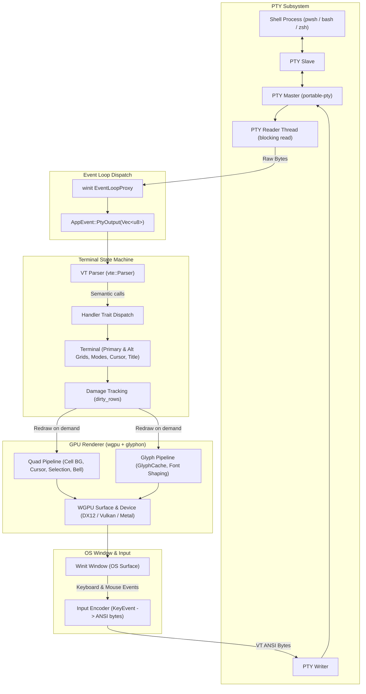
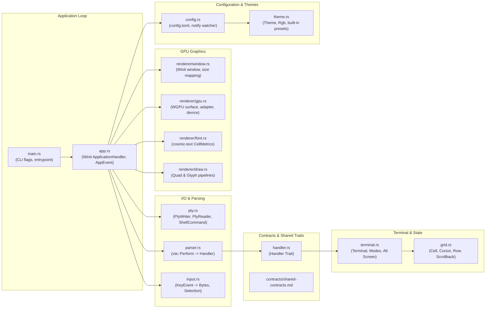

# Oxidite Architecture & Pipeline

Oxidite is an autonomous, cross-platform terminal emulator written entirely in Rust. It directly hosts the shell process over an operating system pseudoterminal (PTY), parses the ANSI/VT control byte stream, tracks terminal state and damage in an in-memory grid, and renders output using GPU-accelerated text and quad pipelines.

---

## 1. Core End-to-End Pipeline

---

## 2. Module Ownership & Package Boundaries

---

## 3. Data Flow Rules & Invariants

1. **Non-blocking UI Thread**: The main GUI event loop thread never blocks on PTY I/O. Reading occurs on a dedicated background thread, which communicates asynchronously via `EventLoopProxy<AppEvent>`.
2. **Single-threaded State Mutation**: Only the main UI thread mutates the `Terminal` and `Grid` state.
3. **On-Demand Redrawing**: The renderer redraws strictly upon damaged rows or visual timers (cursor blink, visual bell). When the terminal is idle, CPU usage sits near 0.0%.
4. **Coalesced Batching**: High-volume outputs (`cat`, `seq`) are coalesced in memory so that parsing occurs across combined buffers before issuing GPU render passes.
5. **Strict Hierarchy**:
   - `pty.rs` owns OS process spawning and pipes.
   - `parser.rs` owns escape tokenization with zero knowledge of cells or pixels.
   - `grid.rs` and `terminal.rs` maintain character grids with zero graphics dependencies.
   - `renderer/` inspects terminal state read-only to produce vertex buffers and glyph shapes.
   - `input.rs` inspects terminal modes read-only to produce byte sequences for the PTY.

## 4. Desktop Workspace Layout

Oxidite uses a custom `winit` + `wgpu` renderer; there is no browser layout
engine. `App::compute_pane_geometry` in `src/app.rs` is the source of truth for
the horizontal columns and vertical content bounds. It returns the sidebar,
terminal, optional diff, optional Git rail, and status-bar allocations. The
renderer, label generation, pointer hit testing, and `App::handle_resize` use
that same value so a pane cannot calculate its size from the whole window while
another uses its parent width.

The sidebar's Sessions entries and the top tab strip refer to the same
workspace terminal tabs; they are two navigation affordances for one session,
not separate shells or duplicated PTYs.

The terminal/diff split is optional. With no diff open, terminal panes take the
entire space after the sidebar. Opening a changed file creates a controlled
terminal/diff split and closes the Git rail. Closing the diff returns to the
same terminal tab and pane tree; its PTYs remain owned by the tab. Changes and
Commit History are the Git-backed views selected from the sidebar.

Within a terminal tab, `PaneTree` recursively divides its parent rectangle.
Each leaf calculates grid rows and columns from its own pixel bounds and the
measured cell size. Split creation checks the active grid, and layout clamps
ratios against per-pane minimum dimensions when possible. The application
state stores sidebar width/visibility and each workspace's tabs and split
tree; OS processes are kept alive during workspace switches and are started
fresh when a saved session is restored.
